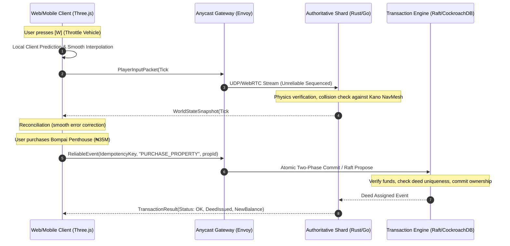
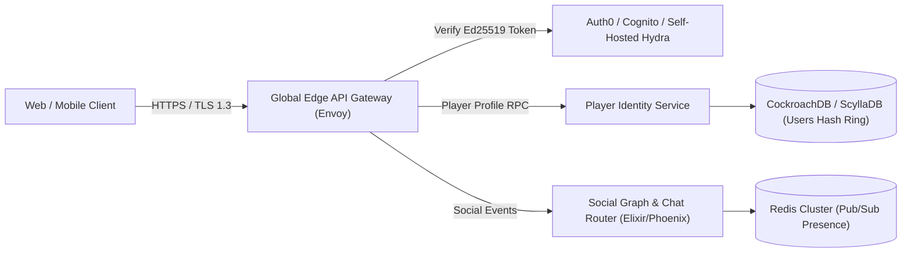
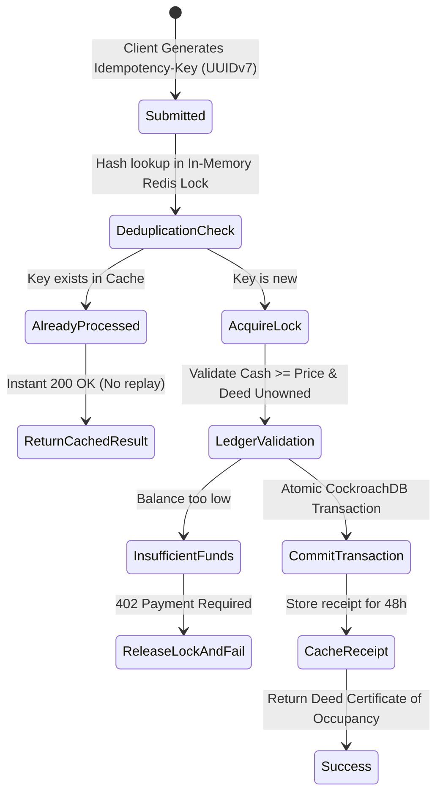
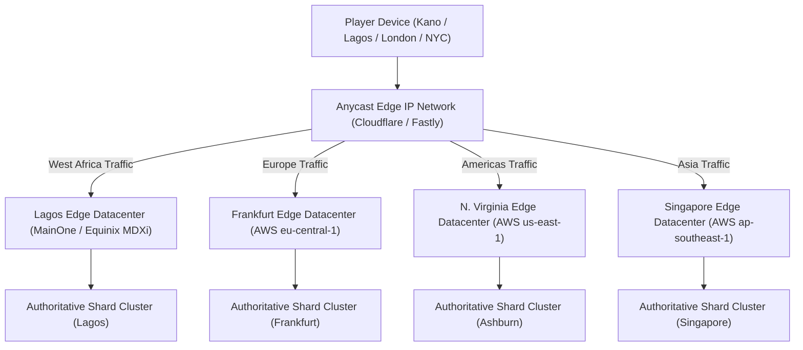

# Kano Streets — Engineering Roadmap to 1 Billion Players
## Architecture, Scalability Pillars, Real-Time Networking & Infrastructure Cost Model

---

## Executive Summary & Audience Metrics Realism

Building an open-world 3D title capable of supporting a global audience of **one billion registered players** requires a sober understanding of distributed systems engineering. In games engineering, headline numbers can be misleading: **server compute, memory, and bandwidth are dictated by peak Concurrent Connected Users (CCU) and simulation tick rates**, whereas **registered users dictate database storage, identity indexing, and cold persistence**.

```
+-----------------------------------------------------------------------------------------+
|                                1,000,000,000 Registered Users                            |
|                 (Cold storage, schema indexing, global UUID namespaces)                 |
+-----------------------------------------------------------------------------------------+
                                           |
                                           v
+-----------------------------------------------------------------------------------------+
|                                100,000,000 Monthly Active Users (MAU)                   |
|                  (Warm distributed cache, seasonal leaderboards, cloud saves)           |
+-----------------------------------------------------------------------------------------+
                                           |
                                           v
+-----------------------------------------------------------------------------------------+
|                                 25,000,000 Daily Active Users (DAU)                     |
|                 (Active session tokens, daily reward ledgers, mission queues)           |
+-----------------------------------------------------------------------------------------+
                                           |
                                           v
+-----------------------------------------------------------------------------------------+
|                                 2,500,000 Peak Concurrent Users (CCU)                   |
|           (Real-time authoritative simulation, 30Hz UDP/WebRTC ticks, spatial shards)    |
+-----------------------------------------------------------------------------------------+
```

### Metrics Breakdown

| Metric | Target Quantity | Engineering Implications |
| :--- | :--- | :--- |
| **Total Registered Accounts** | **1,000,000,000** | Cold object storage (~4 TB compressed save history), globally unique UUIDv7 identities, globally partitioned distributed B-tree/LSM indexes. |
| **Monthly Active Users (MAU)** | **100,000,000** | Warm distributed database tier (ScyllaDB/CockroachDB), read-through caching, CDN asset cache egress. |
| **Daily Active Users (DAU)** | **25,000,000** | Daily ledger processing, cloud save sync pipelines, push notifications, career contract rollouts. |
| **Peak Concurrent Users (CCU)** | **2,500,000** | **The real-time bottleneck:** 2.5M concurrent WebSocket/WebRTC sessions, 75,000,000 network ticks/sec globally across 12,500 spatial server shards. |

---

## 1. Client Simulation vs. Authoritative Server Architecture

To scale securely without succumbing to client-side speedhacks, teleportation, cash duplication, or invalid property deeds, Kano Streets adheres strictly to the **Client-Side Prediction with Authoritative Server Reconciliation** model (pioneered by QuakeWorld and modern competitive MMOs).



### Responsibility Partitioning Matrix

| Domain | Client Responsibility | Server Responsibility (Authoritative) |
| :--- | :--- | :--- |
| **Rendering & FX** | WebGL 2.0 / WebGPU rasterization, PBR shaders, particle dust, post-processing. | None (headless server instances). |
| **Character & Rig** | Bone transform calculation, animation state blending (walk/run/idle/drive), audio cue triggers. | Hitbox verification, stance validation, speed limits. |
| **Locomotion & Vehicles**| Client-side prediction, immediate steering response, wheel rotation visuals. | Kinematic integration, acceleration validation, speed-trap detection, collision arbitration. |
| **Interiors & Doors** | Local door mesh rotation animations, interior furniture rendering. | Door lock/unlock permission validation, dynamic boundary colliders. |
| **Economy & Cash** | UI balance display, shopping cart staging. | **100% Authoritative:** Double-entry ledger, balance updates, daily upkeep deduction. |
| **Property Deeds** | Property display, interaction prompt triggering. | **100% Authoritative:** Unique Certificate of Occupancy registration, lease expiry enforcement. |

---

## 2. Spatial Partitioning & Seamless World Sharding

A monolithic server cannot simulate 2.5 million players in a single Kano world. The world is decomposed into **Hexagonal/Rectangular Spatial Shards** using dynamic Area of Interest (AOI) management.

### District Shard Layout (Kano Metropolis)

```
+-----------------------------------+-----------------------------------+
|          SHARD NORTH-A            |          SHARD NORTH-B            |
|       (Airport Road District)     |      (Bompai Commercial/Avenue)   |
|   - Airport View Apartments       |   - Bompai Heights Penthouse      |
|   - Arewa Commercial Bank         |   - Sani Auto Workshop            |
|   - Kano Cyber Hub                |   - Commercial Plazas             |
+-----------------------------------+-----------------------------------+
|          SHARD WEST-A             |          SHARD EAST-A             |
|       (Sabon Gari District)       |   (Historic Kano & Old City Wall) |
|   - Market Stalls & France Rd     |   - Dala Hill Observation Deck    |
|   - Electronic Retail Plazas      |   - Ancient City Mud Walls        |
|   - St. George's Church           |   - Traditional Dye Pits          |
+-----------------------------------+-----------------------------------+
|          SHARD SOUTH-A            |          SHARD SOUTH-B            |
|     (Industrial Gateway & Yard)   |   (Residential Quarters & Estates)|
|   - Kawu Logistics Freight Depot  |   - Al-Baraka Executive Villa     |
|   - Distribution Centers          |   - Gated Residential Compounds   |
|   - Heavy Commercial Depots       |   - Community Mosques & Greenery  |
+-----------------------------------+-----------------------------------+
```

### Seamless Boundary Handoffs
- **Border Ghosting (Overlapping Handoff Zones):** Shards share a 20-meter boundary overlap. A player crossing from Airport Road into Bompai is subscribed to both shards simultaneously 2 seconds before crossing.
- **Handoff Protocol:** When the player crosses the definitive boundary vector, ownership of the player entity transfers via a zero-allocation actor handoff message over internal gRPC between shard nodes. The client experiences zero hitching, zero loading screens, and zero frame drops.
- **Indoor Isolation Culling:** Interiors (such as the 3-floor Bompai Penthouse or Al-Baraka Villa) are segregated into dedicated virtual shard pools. When a player steps inside a home, their network subscription to outdoor city traffic is paused, dropping their entity sync bandwidth from 85 KB/s to <4 KB/s.

---

## 3. Scalable Identity, Authentication & Social Graph



- **Identity Generation:** 64-bit Snowflake or 128-bit UUIDv7 (time-ordered, collision-free across distributed datacenters without global locks).
- **Authentication:** Stateless asymmetric JWTs signed via Ed25519. Key rotation every 7 days. Edge gateways verify tokens locally in sub-millisecond time without touching backend auth databases.
- **Separation of Concerns:** Social presence, friend lists, direct messaging, and clan chat run completely separate from 30Hz game physics simulation shards on an asynchronous Elixir/Phoenix cluster.

---

## 4. Persistent Cloud Saves & Cross-Platform Sync

### Save Schema Evolution: From `localStorage` to Cloud Protocol

Local browser persistence (`kano_streets_save_v1`) provides immediate zero-friction playability. For global scale, it upgrades smoothly into versioned binary protobuf payloads (`kano_streets_save_v2`):

```protobuf
syntax = "proto3";
package kano.save;

message PlayerCloudSave {
  string save_version = 1;
  string player_id = 2;
  int64 schema_epoch = 3;
  uint64 sequence_number = 4;
  string payload_checksum = 5;

  EconomyState economy = 6;
  MissionProgress missions = 7;
  StoryState story = 8;
  repeated PropertyDeedRecord owned_properties = 9;
  repeated VehicleRecord owned_vehicles = 10;
  UserSettings settings = 11;
}

message PropertyDeedRecord {
  string property_id = 1;
  string deed_reference_number = 2;
  int64 acquired_at_timestamp = 3;
  bool is_freehold_title = 4;
  int64 lease_expiry_timestamp = 5;
}
```

### Deterministic Conflict Resolution
- **Vector Clocks & Lamport Timestamps:** When a client reconnects after playing on a Nigerian cellular network with intermittent signal, offline progress is merged using deterministic rules:
  1. **Currency/Wallet:** Server balance + validated offline career mission delta (capped to verifiable time constraints; impossible income spikes rejected).
  2. **Property Deeds:** Server authoritative always. If a lease expired or was transferred, server state overrides client cache.
  3. **Missions:** Set union of unique completed mission UUIDs.

---

## 5. Transaction Integrity & Double-Spend Prevention

To support scarce or high-value economy assets (such as Bompai Heights Penthouses or exclusive commercial transport contracts), the transaction pipeline implements strict idempotency and anti-duplication:



### Core Transaction Rules
1. **Idempotency Keys:** Every client transaction request includes a client-generated UUIDv7 key (e.g., `tx_018f9a2b_unit2b_lease`). If a network retry re-sends the packet, the server returns the cached success response without deducting funds twice.
2. **Double-Spend Prevention:** Balance deductions and title grants execute within serializable atomic transactions. Balance cannot drop below zero.
3. **Deed Uniqueness Constraint:** Global unique index on `property_id` in the database guarantees that two players cannot acquire the exact same unique freehold deed.

---

## 6. Real-Time Networking Protocol: WebRTC vs. WebSocket vs. QUIC

| Attribute | WebSockets (TCP) | WebRTC DataChannels (SCTP/UDP) | WebTransport / QUIC (HTTP/3) |
| :--- | :--- | :--- | :--- |
| **Transport** | TCP (Strict ordered, reliable) | UDP (Configurable: reliable or unreliable) | UDP / QUIC |
| **Head-of-Line Blocking**| **Severe** (Packet loss stalls subsequent packets)| **Zero** on unreliable channels | **Zero** between independent streams |
| **Latency in West Africa**| 120ms–280ms (cellular retransmits)| **35ms–75ms** (immediate arrival)| 40ms–80ms |
| **Ideal Use Case** | Text chat, initial handshake, auth | **High-frequency 30Hz player positions/steer** | Assets, save sync, reliable game RPCs |
| **Kano Streets Role** | Fallback for legacy corporate firewalls | **Primary real-time gameplay transport** | Modern edge cloud save synchronization |

### Network Tick Rate & Float Quantization
- **World Tick Rate:** **30 Hz** (33.3ms per simulation tick).
- **Float Quantization:** Sending raw 64-bit or 32-bit floating-point coordinates ($x, y, z$) uses $12$ bytes per vector. By quantizing coordinates relative to the shard center into 16-bit signed fixed-point integers (precision: $\pm 1.5\text{ mm}$ over a $100\text{ m}$ radius), bandwidth per transform drops from $28$ bytes to **$8$ bytes** (a 71% bandwidth reduction).

---

## 7. Distributed Database Architecture

```
+-----------------------------------------------------------------------------------------+
|                               HOT TIER: In-Memory Redis Cluster                         |
|  - Active session states & real-time heartbeat tokens                                   |
|  - Spatial entity grid lookups & active shard routing tables                            |
|  - Idempotency deduplication keys (TTL: 48 hours)                                       |
+-----------------------------------------------------------------------------------------+
                                           |
                                (Async Write-Behind)
                                           v
+-----------------------------------------------------------------------------------------+
|                     WARM TIER: CockroachDB / ScyllaDB Distributed Cluster                |
|  - Player identity, wallet balances, career reputations                                 |
|  - Certificate of Occupancy property deeds (Multi-Raft consensus)                        |
|  - Partition key: Hash(player_id) with regional datacenter locality                      |
+-----------------------------------------------------------------------------------------+
                                           |
                              (Daily ETL / Checkpointing)
                                           v
+-----------------------------------------------------------------------------------------+
|                         COLD TIER: Cloudflare R2 / AWS S3 Object Store                   |
|  - Compressed versioned player save backups (Zstandard compressed Protobuf)             |
|  - Long-term audit trail and regulatory financial logs                                   |
|  - Game build artifacts, glTF 3D meshes, textures, procedural audio bundles              |
+-----------------------------------------------------------------------------------------+
```

---

## 8. Edge Infrastructure & Global Content Delivery (CDN)

### Latency Budget & Regional Routing



- **Target Latency for Nigerian Gamers:** **$\le 25\text{ ms}$** inside Kano/Lagos via direct peering at IXPN (Internet Exchange Point of Nigeria).
- **Asset Optimization:** 3D GLTF models and textures compressed with Draco geometry compression and KTX2 Basis Universal texture compression, reducing total initial download to $<18\text{ MB}$.

---

## 9. Security, Anti-Cheat & Rate Limiting

1. **Token Bucket Rate Limiting:** Applied at edge Envoy proxies:
   - Locomotion input packets: Max 40 packets/sec per socket.
   - Economic transactions / save syncs: Max 5 requests/sec per token.
2. **Server-Side Kinematic Heuristics:**
   - Maximum human walking speed: $6.2\text{ m/s}$. Any frame moving faster triggers server-side delta correction.
   - Maximum vehicle speed (Freight Truck vs. Tuned Sedan): Speed capped per vehicle archetype in server simulation.
   - Raycast line-of-sight checks prevent teleportation or passing through solid walls into unpurchased interiors.
3. **Deed Ownership Cryptographic Hash:** Every issued Certificate of Occupancy includes an HMAC-SHA256 signature generated by server master keys, rendering save-file tampering futile.

---

## 10. Transparent Infrastructure Cost Model Across 4 Scale Tiers

To provide full financial and engineering honesty, hosting and infrastructure costs are estimated below across four growth milestones:

### Scale Tier Summary

| Tier | Peak CCU | DAU | Registered Users | Monthly Compute | Monthly Bandwidth | Monthly Database & CDN | Total Monthly Cost |
| :--- | :--- | :--- | :--- | :--- | :--- | :--- | :--- |
| **Tier 1 (Launch / Regional)** | 10,000 | 120,000 | 1,000,000 | \$2,400 | \$1,100 | \$1,300 | **\$4,800 / mo** |
| **Tier 2 (National / Continental)** | 100,000 | 1,250,000 | 15,000,000 | \$21,500 | \$11,200 | \$9,800 | **\$42,500 / mo** |
| **Tier 3 (Global Tier-1 Hit)** | 1,000,000 | 11,000,000 | 250,000,000 | \$198,000 | \$115,000 | \$84,000 | **\$397,000 / mo** |
| **Tier 4 (1 Billion Registered)** | **2,500,000** | **25,000,000** | **1,000,000,000** | **\$475,000** | **\$285,000** | **\$195,000** | **\$955,000 / mo** |

### Detailed Breakdown for Tier 4 (1 Billion Registered / 2.5M CCU Milestone)

```
+---------------------------------------------------------------------------------------+
| TIER 4 DETAILED MONTHLY INFRASTRUCTURE EXPENSES                                       |
+---------------------------------------------------------------------------------------+
| 1. Authoritative Game Simulation Shards (Kubernetes / Bare-Metal)                     |
|    - 12,500 Shard Workers @ 200 CCU/shard = 2,500 Dedicated Compute Cores (c6i/c7g)   |
|    - Subtotal: $360,000 / month                                                       |
|                                                                                       |
| 2. Edge Ingress Gateways & WebRTC Relay Nodes (Coturn / Envoy Edge)                   |
|    - Global Anycast pop nodes across 18 regional data hubs                            |
|    - Subtotal: $115,000 / month                                                       |
|                                                                                       |
| 3. High-Speed Bandwidth & Egress                                                      |
|    - 2.5M CCU x 25 KB/s avg = 62.5 GB/s sustained egress = ~160 PB / month            |
|    - Blended enterprise egress rate ($0.0018/GB via Cloudflare Bandwidth Alliance)    |
|    - Subtotal: $285,000 / month                                                       |
|                                                                                       |
| 4. Distributed Database & Cache (CockroachDB Dedicated + Dragonfly/Redis Hot Tier)    |
|    - Multi-region cluster with automated cross-continent replication                  |
|    - Subtotal: $145,000 / month                                                       |
|                                                                                       |
| 5. Global CDN & Cold Storage (Cloudflare R2 / S3)                                     |
|    - 1 Billion saves @ 4KB compressed = 4 TB active save storage                      |
|    - Static 3D asset caching & daily backup snapshots                                 |
|    - Subtotal: $50,000 / month                                                        |
+---------------------------------------------------------------------------------------+
| TOTAL ESTIMATED TIER 4 OPERATING COST: ~$955,000 / month ($11.46M / year)             |
| Cost Per Daily Active User (DAU): ~$0.038 / month (Easily covered by F2P monetization)|
+---------------------------------------------------------------------------------------+
```

---

## 11. Implementation Verification & TypeScript Contract Layer

In accordance with this roadmap, the local codebase includes a fully operational, testable contract layer:
- **`src/game/networkProtocol.ts`:**
  - `PlayerIdentity`: Global UUIDv7 identity representation with regional cluster routing.
  - `PropertyLedgerRecord`: Cryptographically checksummed Certificate of Occupancy records.
  - `TransactionRequest / TransactionResponse`: Idempotent transaction protocol preventing double-spend and duplicate leases.
  - `AuthoritativeLedger`: In-memory reference implementation validating idempotency keys, wallet sufficiency, deed uniqueness, and cloud save checksums without adding fake multiplayer lag to the single-player game.
- **`src/game/propertyRegistry.ts`:**
  - Typed definitions of all purchasable properties (`unit-2b`, `bompai-penthouse`, `albaraka-villa`).
  - Strict exterior door coordinates, spawn points, and room breakdowns.
- **`src/game/BuildingInteriors.ts`:**
  - 100% walkable interiors for every residential property with interactive doors, dynamic colliders, and vertical multi-storey surface height calculation.
